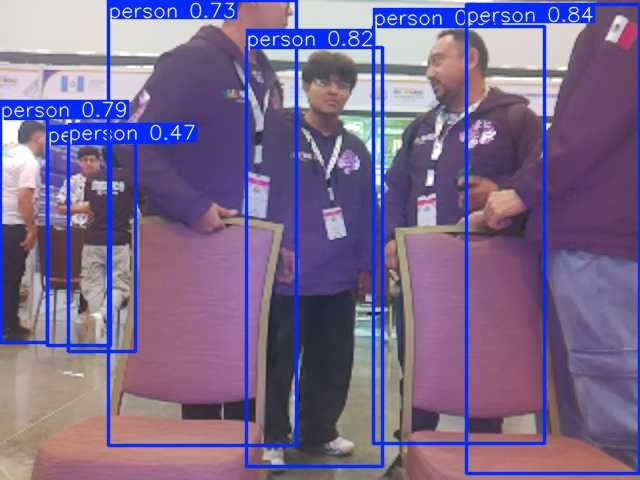
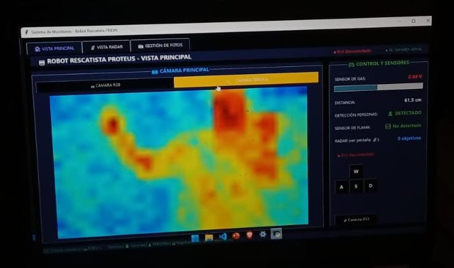

#  Robot Rescatista PROTEUS

> Robot autónomo de búsqueda y rescate con inteligencia artificial, detección de personas en tiempo real y comunicación inalámbrica independiente de internet.

---

##  Galería

### Vista del Robot

| Vista frontal | Vista lateral |
|:-:|:-:|
|  |  |

---

### IA — Detección de Personas (YOLOv8n NCNN)

| Detección RGB | Detección térmica |
|:-:|:-:|
|  |  |

---

##  Descripción del Proyecto

**PROTEUS** es un robot de búsqueda y rescate construido sobre una base **LEGO Mindstorms EV3**, equipado con una **Raspberry Pi 5** como cerebro de procesamiento. El sistema integra múltiples sensores ambientales, visión artificial con YOLOv8, radar milimétrico y un asistente de voz con IA que permitía al robot comunicarse con las víctimas, con el objetivo de asistir a equipos de rescate en entornos peligrosos y salvar la mayor cantidad de vidas posible.

Una característica clave del proyecto es que **no depende de internet**: la Raspberry Pi genera su propio **hotspot WiFi**, permitiendo que la laptop del operador se conecte directamente al robot y reciba toda la telemetría en tiempo real desde cualquier lugar.

### Características principales

-  **Detección de personas** con YOLOv8n (NCNN, optimizado para ARM) en tiempo real
-  **Captura automática de fotos** al detectar personas, con registro de timestamps
-  **Visión térmica** para detectar calor corporal con MLX90640
-  **Radar milimétrico** RD-03D para rastrear hasta 3 objetivos simultáneos
-  **Navegación autónoma** con RPLidar A1 2D (360°)
-  **Detección de gases y llamas** con sensor MQ2 y sensor digital de flama
-  **Asistente de voz** con Gemini 2.5 Flash y síntesis de voz en español
-  **Panel de monitoreo** completo en GUI (PC) con cámara RGB, térmica, radar, sensores y log CSV
-  **Red independiente** vía hotspot del Raspberry Pi — sin internet requerido
- 🏆 **Presentado en la WRO 2025 Open Championship Americas**

---

## 🧰 Hardware

### Componentes y Sensores

| Componente | Descripción | Función en el robot |
|---|---|---|
|  **LEGO Mindstorms EV3** | Plataforma robótica con 4 motores | Cuerpo del robot y locomoción (4 ruedas) |
|  **Raspberry Pi 5 (8GB RAM)** | Unidad de procesamiento principal | Procesamiento de IA, lectura de sensores, hotspot WiFi |
|  **Cámara OV5647** | Cámara RGB 5MP | Detección de personas con YOLOv8n |
|  **Cámara Térmica MLX90640** | Sensor IR 32×24 px | Detección de calor corporal en oscuridad |
|  **Radar RD-03D** | Radar milimétrico 24GHz | Detección de movimiento y distancia (hasta 3 targets) |
|  **RPLidar A1 2D** | Escáner láser 360° | Navegación autónoma y evitación de obstáculos |
|  **Sensor de Gas MQ2** | Detector de gases combustibles | Detección de humo, gas LP y metano |
|  **ADS1115** | ADC 16-bit I2C | Conversión analógica de la señal del MQ2 |
|  **Ultrasónico RCWL-1605** | Sensor de distancia 2–450cm | Medición de proximidad de obstáculos |
|  **Sensor de Flama digital** | Detección infrarroja de llama | Detecta fuego hasta ~80cm (salida DOUT) |
|  **UPS HAT (E)** | Sistema de alimentación ininterrumpida | Alimentación estable y portátil para la Raspberry Pi |

---

## 🗂️ Estructura del Proyecto

```
Robot_Rescatista_Proteus/
│
├── CONEXION.py        #  Raspberry Pi — Lee sensores y transmite por sockets TCP
├── RECEPTOR.py        #  PC — GUI principal: monitoreo, control EV3, fotos y alertas
├── IAMOVIMIENTO.py    #  PC — Navegación autónoma con LiDAR
├── IA_VOZ.py          #  PC — Asistente de voz con Gemini AI
├── main.py            #  EV3 — Recibe comandos y controla los 4 motores
│
├── images/            # ← Sube tus fotos aquí
│   ├── robot_proteus.JPEG
│   ├── robot_proteus2.JPEG
│   ├── persona_detectada1.jpg
│   ├── Camara_termica.jpeg
│   └── ...
│
└── README.md
```

---

##  Arquitectura del Sistema

```
                ┌──────────────────────────────────────────────┐
                │            RASPBERRY PI 5 (8GB)              │
                │               [ CONEXION.py ]                │
                │                                              │
                │  OV5647     MLX90640    RD-03D    MQ2+Llama  │
                │  YOLOv8n    Térmica     Radar     Gas+Flama  │
                │  :6002      :6001       :6003     :6000      │
                │                                              │
                │  RPLidar A1 2D ──────── :6005                │
                │                                              │
                │  📶 Hotspot WiFi propio — sin internet       │
                └────────────────────┬─────────────────────────┘
                                     │
                           WiFi (red del robot)
                                     │
                ┌────────────────────┴─────────────────────────┐
                │                LAPTOP / PC                   │
                │                                              │
                │  ┌──────────────────────────────────────┐    │
                │  │           RECEPTOR.py                │    │
                │  │  GUI principal — tkinter             │    │
                │  │  • Cámara RGB + detección YOLOv8     │    │
                │  │  • Cámara térmica MLX90640           │    │
                │  │  • Radar RD-03D (visualización)      │    │
                │  │  • Sensores: gas, distancia, flama   │    │
                │  │  • Captura fotos al detectar persona │    │
                │  │  • Alertas sonoras (gas / flama)     │    │
                │  │  • Log CSV de telemetría             │    │
                │  │  • Control manual del EV3 (teclado)  │    │
                │  │  • Servidor interno :6007 para IA    │    │
                │  └──────────────────────────────────────┘    │
                │                                              │
                │  ┌───────────────┐   ┌──────────────────┐   │
                │  │ IA_VOZ.py     │   │ IAMOVIMIENTO.py  │   │
                │  │ Asistente voz │   │ Navegación LiDAR │   │
                │  │ Gemini 2.5    │   │ autónoma 360°    │   │
                │  └───────────────┘   └────────┬─────────┘   │
                └───────────────────────────────│─────────────┘
                                                │
                                    Comandos TCP :6007 / :12345
                                                │
                ┌───────────────────────────────┴──────────────┐
                │              EV3  [ main.py ]                │
                │  Motores A, B, C, D — locomoción 4 ruedas    │
                │  Puerto 12345 ← comandos (w / s / a / d / x) │
                └──────────────────────────────────────────────┘
```

---

## ⚙️ Puertos de Comunicación

| Puerto | Ejecutado en | Datos que transmite |
|---|---|---|
| `6000` | Raspberry Pi | Voltaje gas MQ2, distancia ultrasónica, flag de flama |
| `6001` | Raspberry Pi | Frame JPEG cámara térmica MLX90640 coloreado (320×240) |
| `6002` | Raspberry Pi | Frame JPEG con detecciones YOLOv8 + flag de persona detectada |
| `6003` | Raspberry Pi | Hasta 3 targets del radar: distancia (mm), ángulo (°), velocidad |
| `6005` | Raspberry Pi | Nube de puntos LiDAR 360° para navegación autónoma |
| `6007` | PC (RECEPTOR) | Servidor interno que recibe comandos de `IAMOVIMIENTO.py` y los reenvía al EV3 |
| `12345` | EV3 | Recibe comandos de movimiento desde la PC vía TCP |

---

##  Comandos de Control

| Tecla | Acción |
|---|---|
| `w` | Girar izquierda |
| `s` | Retroceder |
| `a` | Avanzar |
| `d` | Girar derecha |
| `x` | Parar |
| `q` | Desconectar |

---

##  Instalación y Uso

### Preparar el EV3

El EV3 corre **ev3dev** (Linux para Mindstorms) flasheado en una microSD, lo que permite ejecutar Python estándar en lugar del firmware original de LEGO.

> Guía oficial: [ev3dev.org/docs/getting-started](https://www.ev3dev.org/docs/getting-started/)

### Requisitos en Raspberry Pi 5

```bash
pip install numpy opencv-python picamera2 ultralytics
pip install adafruit-circuitpython-mlx90640
pip install adafruit-circuitpython-ads1x15
pip install gpiozero rd03d
```

### Requisitos en PC / Laptop

```bash
pip install numpy opencv-python pillow
pip install SpeechRecognition google-generativeai gtts pygame pyaudio
```

### Orden de ejecución

> ⚠️ Conectar la laptop al **hotspot WiFi del Raspberry Pi** antes de iniciar los scripts de PC.

**1. EV3** — arranca al conectarse vía ev3dev:
```bash
python3 main.py
```

**2. Raspberry Pi** — lanza todos los servidores de sensores:
```bash
python3 CONEXION.py
```

**3. PC / Laptop** — panel de monitoreo principal:
```bash
python3 RECEPTOR.py       # GUI principal: cámara, radar, sensores, control EV3
python3 IA_VOZ.py         # (opcional) asistente de voz con Gemini
python3 IAMOVIMIENTO.py   # (opcional) navegación autónoma con LiDAR
```

---

##  Módulos de IA

### Detección de Personas — YOLOv8n NCNN
Modelo YOLOv8n exportado a formato NCNN para correr eficientemente en la arquitectura ARM de la Raspberry Pi 5. Detecta únicamente la clase `person` y transmite al cliente el frame anotado junto con un flag binario. Al detectar una persona, `RECEPTOR.py` guarda automáticamente una foto con timestamp y dispara una alerta sonora.

### Asistente de Voz — Gemini 2.5 Flash
Asistente activado por wake words personalizadas. Usa Google Speech Recognition para transcripción en español y gTTS para síntesis de voz, permitiendo al robot comunicarse con las víctimas. Cada sesión se guarda automáticamente en un archivo JSON local.

### Navegación Autónoma — RPLidar A1 2D
Procesa la nube de puntos 360° del LiDAR para detectar obstáculos en tiempo real. Genera los comandos de movimiento automáticamente y los envía al EV3 a través del servidor interno de `RECEPTOR.py` en el puerto `6007`.

---

## 🏆 WRO 2025 Open Championship Americas

Este proyecto fue presentado en la **World Robot Olympiad (WRO) 2025 Open Championship Americas**, donde PROTEUS compitió en la categoría Future Innovators Senior alcanzo el 6to lugar internacional y siendo el SEGUNDO mejor equipo de México.

---

## 📄 Licencia

Este proyecto fue desarrollado con fines académicos y de investigación.

---

> 🛠️ Desarrollado por [@gabescamilla2-sketch](https://github.com/gabescamilla2-sketch)